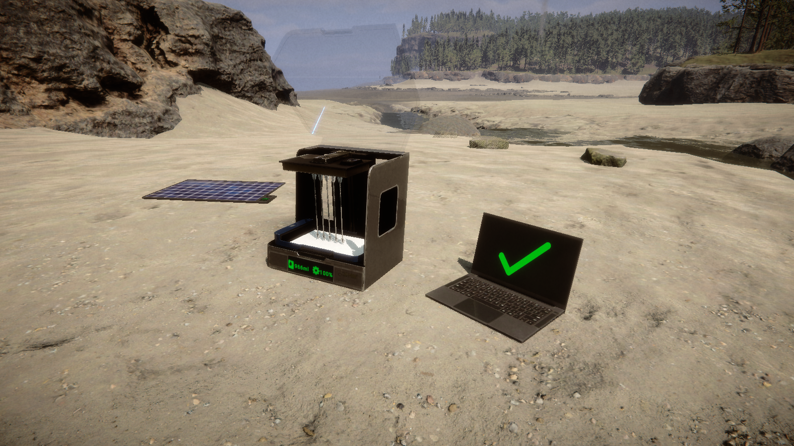
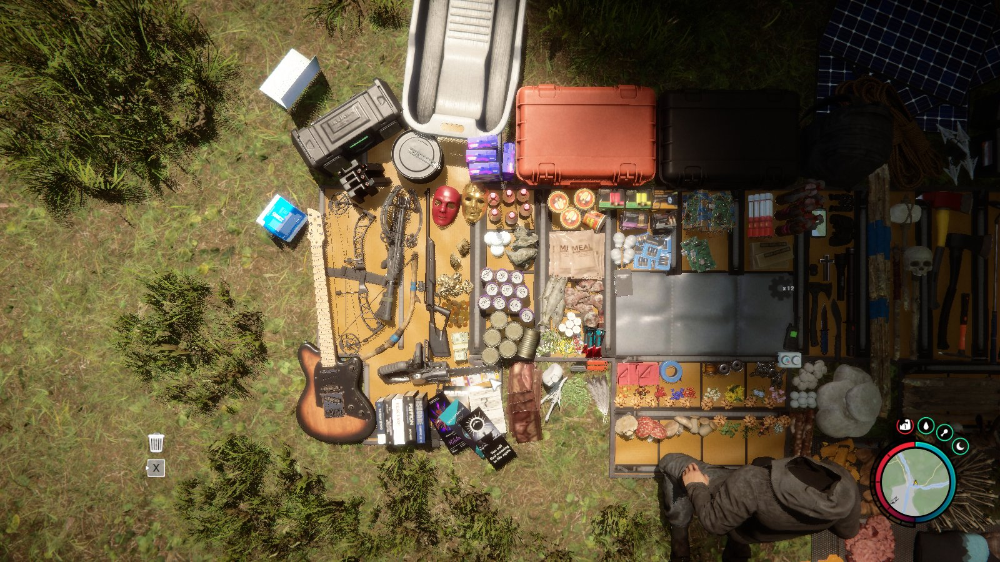
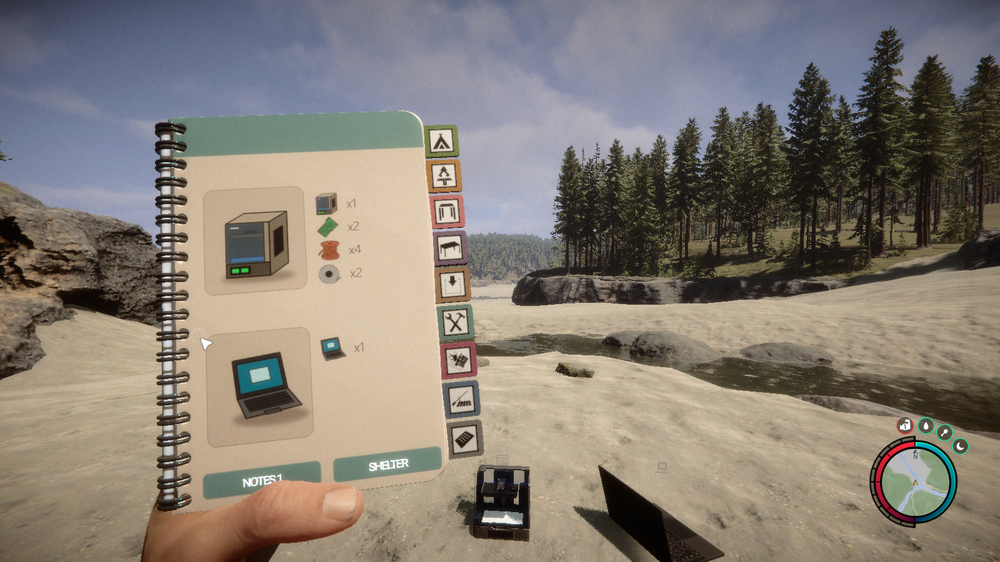
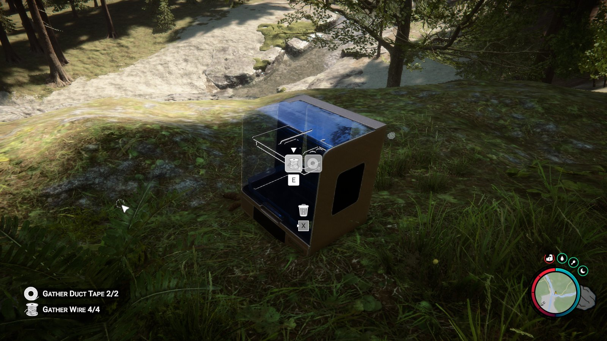
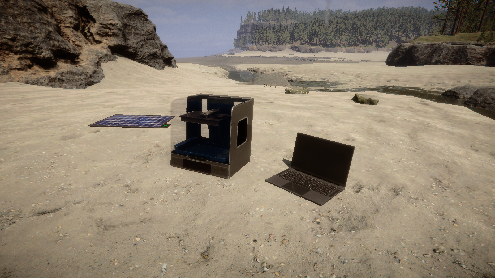
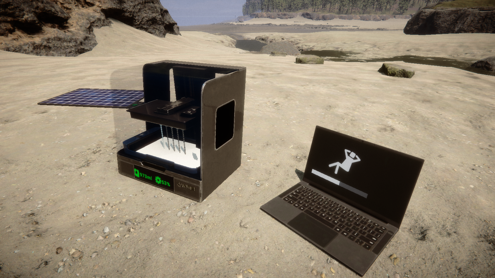

# Bring the Printer

Take a 3D printer home. Break a bunker printer for parts, take its laptop, rebuild both at your base from the blueprint book and power them with a solar panel.



Single player and multiplayer (every player needs the mod). Requires [RedLoader](https://github.com/ToniMacaroni/RedLoader) 0.8.6.

## Features

- Bunker 3D printers break when you hit them and drop **3D Printer Parts**.
- Hit a bunker laptop to knock it loose and pick it up as a **Printer Laptop**.
- A new blueprint book page with the **3D Printer** and the **Printer Laptop**. Place them and add the materials like any other blueprint.
- Both are electric structures, like lamps. Wire the laptop to the printer and the printer to a solar panel.
- Without power they are off: dark screens, no interaction, and a running print pauses until power comes back.
- The rebuilt printer is a real game printer: refill it with resin, pick a blueprint on the laptop, print.
- Rebuilt printers, laptops, resin, running print jobs, dropped items and unfinished blueprints are kept in your save. A print resumes when power is back.
- Bunker printers work as before, without power, and come back so you can always get more parts.

## Tutorial

1. **Find a bunker printer.** Entertainment, Residential, Bunker A or Bunker B.
2. **Take the laptop.** Hit the laptop once. It drops as a **Printer Laptop** you can pick up. It can't be taken while it is printing.
3. **Break the printer.** Hit it until it breaks (three axe hits) and pick up the **3D Printer Parts**.

   

4. **Place the blueprints.** Open the blueprint book on the **3D Printer** page and place the printer and the laptop.

   

5. **Add the materials** with **E**, like any other blueprint:

   | Structure | Materials |
   |---|---|
   | 3D Printer | 3D Printer Parts x1, Circuit Board x2, Wire x4, Duct Tape x2 |
   | Printer Laptop | Printer Laptop x1 |

   

6. **Wire it up.** With the wire tool, connect the laptop to the printer and the printer to a solar panel.

   

7. **Refill and print.** Once powered, the laptop links to the printer on the same wire. Refill the printer with resin and print.

   

## Good to know

- A solar panel gives no power at night. Add a battery to keep printing after sunset.
- One laptop per printer. Extra laptops on the same wire stay unlinked.
- Destroy a rebuilt printer or laptop like any structure. It drops its 3D Printer Parts or Printer Laptop so you can move it.
- Wires are saved by the game like any other wire.
- A bunker printer comes back when you are more than 60 m away from it.

## Multiplayer

Works in multiplayer. Every player needs the mod installed.

- Rebuilt printers and laptops are real network objects. Resin, print progress, pause and the laptop link use the game's own printer sync.
- The host decides when a bunker printer breaks and drops its parts. It comes back when the host is more than 60 m away. Other players see the same state.
- Everything is saved in the host's save game.

## Console commands (F1)

- `spawnprinter` puts a printer and a laptop in front of you (single player or host).
- `breakprinter` breaks the bunker printer you are looking at.

## Build

```
dotnet build -c Release
```

It copies the mod to `<game>\Mods` and creates `ReleaseBuild\BringThePrinter.zip`. The game path is `GameDir` in `BringThePrinter.csproj.user`.
